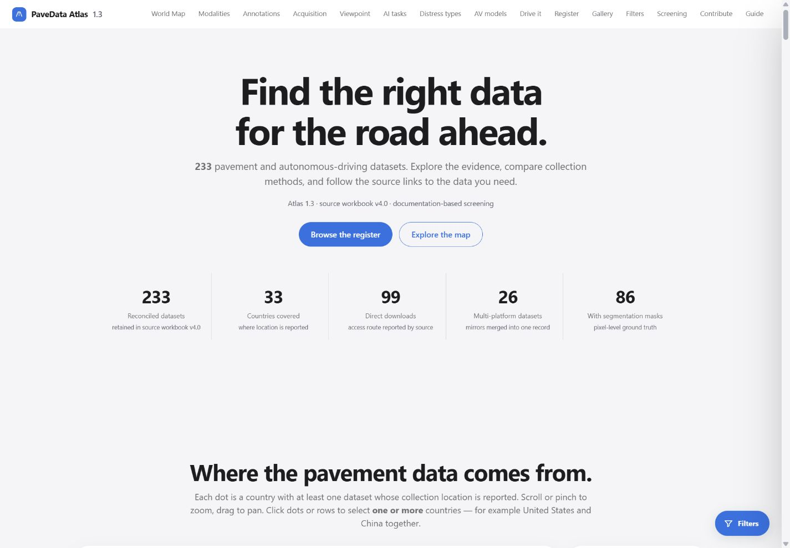
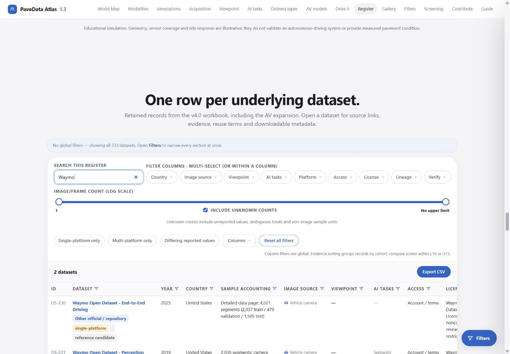
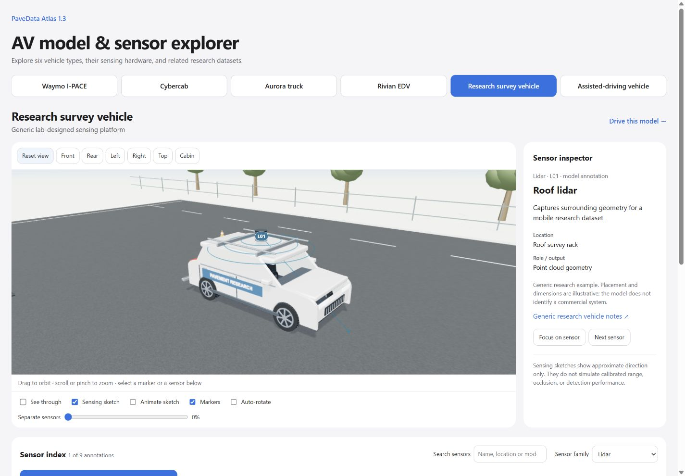
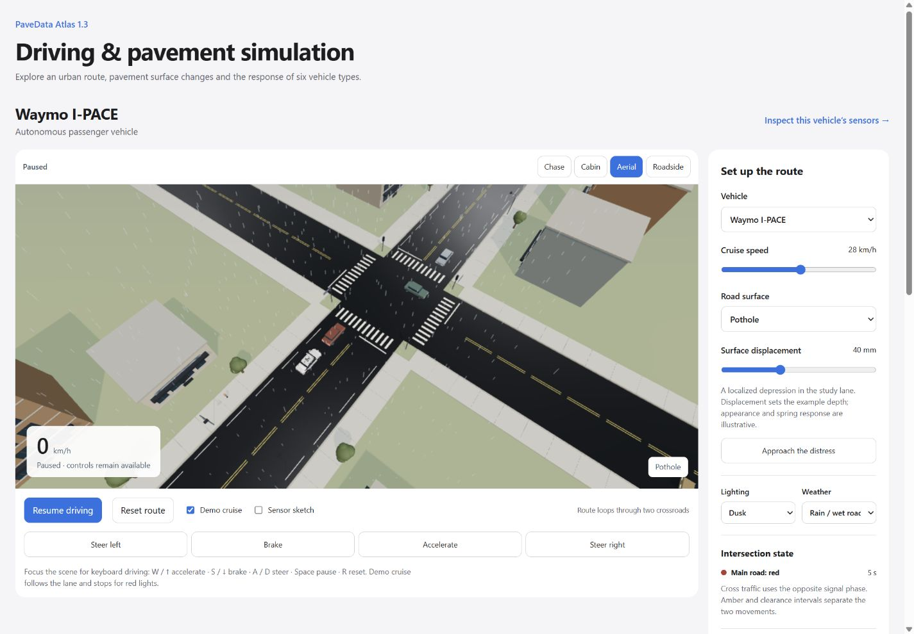
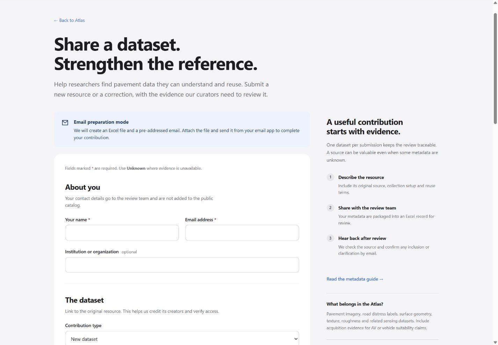

# PaveData Atlas 1.3

A reference website for finding and comparing pavement and road-scene datasets, exploring vehicle sensing, and understanding illustrative responses to road distress. Version 1.3 preserves the Atlas's light visual style and section structure while updating its catalog and selection method from **Compared_All_Platforms_TH_v4.0.docx** and **Compared_All_Platforms_TH_v4.0.xlsx**.

[Explore the Atlas](index.html) · [User guide](guide.html) · [Vehicle and sensor lab](av-model-simulation.html) · [Driving simulation](driving-simulation.html) · [Contribute](submit.html) · [Metadata guide](schema.html) · [Update history](CHANGELOG.md)

Repository: [AmbientIntelligence-Lab/Pavement_Atlas](https://github.com/AmbientIntelligence-Lab/Pavement_Atlas). GitHub Pages deployment target: [ambientintelligence-lab.github.io/Pavement_Atlas](https://ambientintelligence-lab.github.io/Pavement_Atlas/). A successful GitHub Actions deployment confirms which revision is live.

## What is in this release?

| Area | Version 1.3 |
| --- | --- |
| Catalog | **233 retained dataset/release records**: 177 existing records plus 56 retained AV additions |
| Source reconciliation | **248 source rows**: 177 previous rows and 71 AV rows; 15 AV aliases merged into retained records |
| Scoring profiles | **229 Labeled-16** records and **4 Unlabeled-13** records; compare scores within the same profile |
| Core selection method | 16 checks across six dimensions, with evidence states and lower–upper bounds |
| Vehicle lab | Six vehicles, interactive sensor selection, source notes, GLB export and related datasets |
| Road simulation | Two crossroads, signals, surrounding traffic, eight surface features plus a smooth reference, weather and lighting controls |
| Contributions | Separate metadata form, required name/email, real Excel export and a deployable email receiver |

The catalog records resources and their documented properties. It does not host the full datasets or establish that each release is an independent acquisition corpus. Original source wording, merge history and unresolved evidence remain available. See [data provenance and limitations](data/DATA_NOTES.md).

## Find a dataset and use its evidence

1. Start in the **dataset register**. Search by name or a relevant term, then narrow the results with the available facets. The global filter panel coordinates the map, dataset views, register, gallery and screening.
2. Use the map and the modality, annotation, acquisition-platform, viewpoint, task and distress views to understand the selection. National map anchors summarize stated country coverage; they are not recording coordinates. Credited sample images are not available for every record.
3. Open a dataset's detail page. Permanent links use `dataset.html?id=DS-001`. Read its source/access terms, acquisition context, annotation details, cohort and per-check evidence before deciding whether it fits your task.
4. Follow the original source or access link for the data. Observe the publisher's license, registration and citation requirements. Missing information stays unknown; a high documentation score does not establish permission to reuse or successful retrieval.
5. Use **Export CSV** for the current register selection. Detail pages offer **metadata JSON** and **BibTeX** downloads. The complete [catalog JSON](data/catalog.json), [source workbook](data/Compared_All_Platforms_TH_v4.0.xlsx) and [methodology document](data/Compared_All_Platforms_TH_v4.0.docx) are also included.





The [user guide](guide.html) explains the register, detail pages, scoring and citation. Existing identifiers `DS-001`–`DS-177` are preserved; new retained records use `DS-178`–`DS-233`.

## Understand the revised selection criteria

| Dimension | Active core checks | Meaning |
| --- | --- | --- |
| A · Access | A1, A2, A3 | Identifiable release, access route and data terms |
| L · Annotation evidence | L1, L2, L4 | Target definitions, encoding/procedure and review practice |
| D · Documentation | D1, D2, D4 | File interpretation, provenance and stated limitations |
| C · Sample accounting | C1, C2 | Release count/unit and relevant class or subset counts |
| R · Collection context | R1, R2 | Recording setting, variation or explicit boundaries |
| M · Acquisition details | M1, M2, M5 | Equipment, resolution/sampling and processing |

**Labeled-16** uses all six dimensions with equal baseline weights of 1/6. **Unlabeled-13** excludes annotation evidence for the entire cohort and uses equal weights of 1/5 across A/D/C/R/M. Its four records are CUPAC, comma2k19, Ford Multi-AV and NATIX Multi-Camera. Each profile is labeled; the screening list compares one cohort at a time. Custom weights are exploratory.

The effective states are **Y** (supported), **N** (affirmative failure), **U** (missing, inaccessible, untested or insufficient evidence), and **X** (unresolved conflict). U and X widen the interval; they do not become failures. For a dimension with `m` applicable checks, lower = `5 × Y / m` and upper = `5 × (Y + U + X) / m`. Weighted totals use unrounded values.

These intervals summarize documentation evidence. They are not confidence intervals, measured dataset quality or AV certification. Benchmark Readiness (V) and Engineering Linkage (E) remain conditional modules outside the common core. G1 identity, G2 task-fit, G3 rights/retrieval and G4 benchmarking-leakage gates remain separate. Source assessments are provisional where review is pending.

All 40 historical definitions remain in [rubric.json](data/rubric.json), with their current roles; only the revised core contributes to the index. The importer and browser scoring checks reproduce all **699** saved lower/upper/resolved baseline values across the 233 records. See [DATA_NOTES.md](data/DATA_NOTES.md) and [provenance.json](data/provenance.json) for source hashes, relationships and outstanding evidence issues.

## Explore vehicles and sensors

Open the embedded **AV model and sensor interactions** section or the [full vehicle lab](av-model-simulation.html). The fleet includes:

- **Waymo I-PACE:** educational autonomous passenger-vehicle reconstruction.
- **Cybercab:** educational autonomous passenger-vehicle concept reconstruction.
- **Aurora truck:** educational autonomous freight-tractor reconstruction.
- **Rivian EDV:** driver-operated delivery van with assistance systems.
- **Research survey vehicle:** original generic lab platform with cameras, roof LiDAR, GNSS/inertial recording and rear road profilers.
- **Assisted-driving vehicle:** original generic driver-supervised camera/radar platform.

Drag to orbit and scroll or pinch to zoom. Choose a view, select a sensor marker or use the searchable sensor index to read its role and sources. Reveal the body, separate sensors and show illustrative sensing directions. Model-specific options expose doors, a trailer or example fleet equipment where provided. **Export GLB** downloads the assembled educational model; it is not manufacturer CAD.

Related-dataset panels link to catalog details and original sources. They distinguish official releases, third-party collections and relevant alternatives. An association does not establish capture by that illustrated vehicle, matching sensor generation, manufacturer endorsement or pavement-distress labels.



Original model notes are retained under [`src/models/`](src/models/). The new configurations are documented in [research vehicle notes](src/models/research-vehicles/SOURCE-README.md). Annotation counts and sensing graphics describe these educational reconstructions; they are not verified production inventories or calibrated coverage.

## Drive an illustrative road scenario

Open **Driving and simulation distress on the road** or the [full driving workspace](driving-simulation.html). Choose a vehicle, start the route and switch between Chase, Cabin, Aerial and Roadside views. The two embedded workspaces share vehicle selection.

**Demo cruise** follows the study lane and stops for red lights. Focus the scene for keyboard input: **W / Up** accelerates, **S / Down** brakes, **A / D** steers within the lane, **Space** pauses, and **R** resets. Visible buttons support touch input. **Approach the distress** returns to the study section.

Choose a smooth reference or one of eight surface features: pothole, transverse cracks, longitudinal cracking, alligator cracking, wheel-path rutting, raised repair patch, surface raveling and utility cover. Adjust example surface displacement and speed. Compare **Daylight / Dusk / Night** with **Dry / Rain–wet road / Fog**. Signals, surrounding traffic, rain, headlights and street lighting add scene context.

The live graph shows a generated vertical body response. **Export generated trace (.csv)** saves the scenario configuration and generated samples. This simplified damped-spring demonstration is **not measured road data, IRI, a distress condition rating, sensor output or an AV safety evaluation**. Weather changes appearance and visibility; it does not establish calibrated tire friction or wet-weather performance.



Three.js 0.180.0 / WebGL 2 powers the 3D workspaces. Use a compatible browser with hardware acceleration. If WebGL is unavailable, use the catalog and textual sensor information. External sources require internet access. See [simulation notes](src/models/SIMULATION-NOTES.md).

## Contribute a dataset or correction

Use the [community submission form](submit.html) and [metadata guide](schema.html). Name and email are required for follow-up, along with dataset name, source URL, release year, reuse terms and consent. Enter **Unknown** for an unverified year or license. For a correction, include the existing `DS-xxx` ID. Contact details are included in the submission workbook and are not automatically published in the catalog.

**Automatic email is currently disabled:** `src/submission-config.js` ships with `endpoint: ''`. The working fallback creates a real `.xlsx` file and provides a pre-addressed email to **tianzhi.he@ami-lab.com**. Attach the workbook and send it from your email app. Downloading a file or opening a draft does not send a submission; the form states this explicitly.

The included Google Apps Script receiver can generate an Excel attachment server-side and send it to the fixed review address. When configured, its receipt thanks the contributor only after the mail service accepts the message. The team then checks the source and confirms the outcome or requests clarification. Sending a contribution does not automatically publish it.



**Owner setup remains required:** create/authorize the lab's Google project, review permissions and retention, deploy the receiver, perform a controlled end-to-end test, and add the verified deployment URL. No live test email was sent during implementation. Follow [docs/SUBMISSIONS.md](docs/SUBMISSIONS.md). Never put OAuth tokens, SMTP passwords or private API keys in the static website or repository.

## Run locally and edit

Keep the contents of `Pavement_Atlas_website_v1.3` together. The earlier `Pavement_Atlas_website` and `Pavement_Atlas_website_v1.2` folders are preserved as separate baselines. They are not required to run or rebuild v1.3.

Use **Node.js 22 or later** and run from this folder:

```sh
npm start
```

Open [http://127.0.0.1:4184](http://127.0.0.1:4184). The committed pages and bundles can be served without installing packages. Use a web server instead of `file://`: detail records, related datasets and JavaScript modules use normal web requests.

To modify and rebuild the 3D source:

```sh
npm install
npm run build
npm run check
```

The build bundles locally installed Three.js and esbuild into the fleet runtime, vehicle explorer and driving page. After `npm install`, a normal build needs no neighboring model project. Versions are declared in `package.json`. Historical one-time migration scripts are not part of normal editing.

`npm run check` runs `node verify.mjs`, including catalog/evidence validation and submission tests. Individual checks are also available:

```sh
node scripts/verify-data.mjs
node integrations/test-submissions.mjs
```

Submission tests use mocked Google services and send no email. They cover validation, text-only XLSX generation, duplicate suppression, fixed-recipient sending, quota/error receipts and cleanup. They do not prove live Google delivery.

### Re-import the source documents

Python is optional for normal use/build. To regenerate the catalog, install `openpyxl` and `python-docx` in your chosen environment:

```sh
python -m pip install openpyxl python-docx
python scripts/import-data.py --source-dir ..
node scripts/verify-data.mjs
```

If the parent folder lacks the source documents, the importer uses the included `data/` copies. It never modifies the originals. Maintain associations in [vehicle-associations.json](data/vehicle-associations.json) and regenerate derived records rather than hand-editing outputs.

### Repository map

| Location | Purpose |
| --- | --- |
| `index.html`, `dataset.html` | Overview/register and permanent dataset details |
| `guide.html`, `schema.html`, `submit.html` | Usage guide, metadata reference and contribution form |
| `av-model-simulation.html`, `driving-simulation.html` | Built 3D workspaces |
| `src/` | Editable UI, scoring, fleet, sensor and simulation code |
| `data/` | Source documents, catalog, rubric, provenance and complete record evidence |
| `assets/` | Local runtime bundles, dataset previews and distress reference images |
| `scripts/` | Data import, validation and public-site packaging |
| `integrations/google-apps-script/` | Separately deployed email receiver and manifest |
| `docs/` | Screenshots and submission deployment instructions |
| `licenses/`, `CREDITS.md` | Third-party licensing and image/model attribution |
| `.github/workflows/pages.yml` | Validation and GitHub Pages deployment |

## Deploy to GitHub Pages

Commit **the contents of this v1.3 folder** into the root of [AmbientIntelligence-Lab/Pavement_Atlas](https://github.com/AmbientIntelligence-Lab/Pavement_Atlas), replacing the corresponding v1.2 files. Include source snapshots, built HTML/bundles, data, documentation and `.github`. Do not upload `node_modules`, temporary files, credentials or personal test submissions.

In **Settings → Pages**, choose **GitHub Actions** as the deployment source. The included [pages.yml](.github/workflows/pages.yml) runs on pushes to `main` or manual dispatch. It validates committed files, stages the public site with `scripts/package-site.mjs`, uploads `_site`, and deploys through the official Pages actions. This workflow uses committed built artifacts: rebuild locally before committing changes to the 3D source.

To inspect the public package:

```sh
npm run check
npm run package:site
```

Relative assets/navigation support the repository's `/Pavement_Atlas/` subpath without a root-domain rewrite. The package includes the public UI, data and integration source as downloadable documentation; it excludes development dependencies. GitHub Pages does not execute or authorize Google Apps Script. Keep email disabled until the separate receiver passes its live checks.

After deployment, check the Actions URL, dataset details, both 3D workspaces, exports, mobile navigation and contribution mode. The receiver's default return address uses the Pages URL above; update it if the site moves or gains a custom domain.

## Cite and credit

Cite the original dataset and follow its authors' instructions when using its data. To identify the Atlas snapshot used for discovery or comparison:

> PaveData Atlas (2026). *PaveData Atlas*, website version 1.3; Compared_All_Platforms_TH_v4.0 dataset and methodology snapshot. https://ambientintelligence-lab.github.io/Pavement_Atlas/ (accessed YYYY-MM-DD).

Replace the access-date placeholder. This suggested website citation does not assert a DOI or publication authorship. Dataset-detail BibTeX identifies the catalog record; it does not replace the original dataset citation.

Dataset previews and distress photographs retain their original rights. Three.js is MIT-licensed. Read [CREDITS.md](CREDITS.md), [licenses/THREE-LICENSE.txt](licenses/THREE-LICENSE.txt) and the vehicle source notes before reusing assets.

The source/detail structure and metadata approach drew inspiration from [OpenConstruction's dataset directory](https://www.openconstruction.org/dataset.html), [detail example](https://www.openconstruction.org/datasets/detail.html?id=camhighways) and [schema reference](https://www.openconstruction.org/schema.html). Atlas pages, interactions, scenes and the contribution implementation were developed independently while preserving the supplied Atlas design. See [CHANGELOG.md](CHANGELOG.md) for release history.
